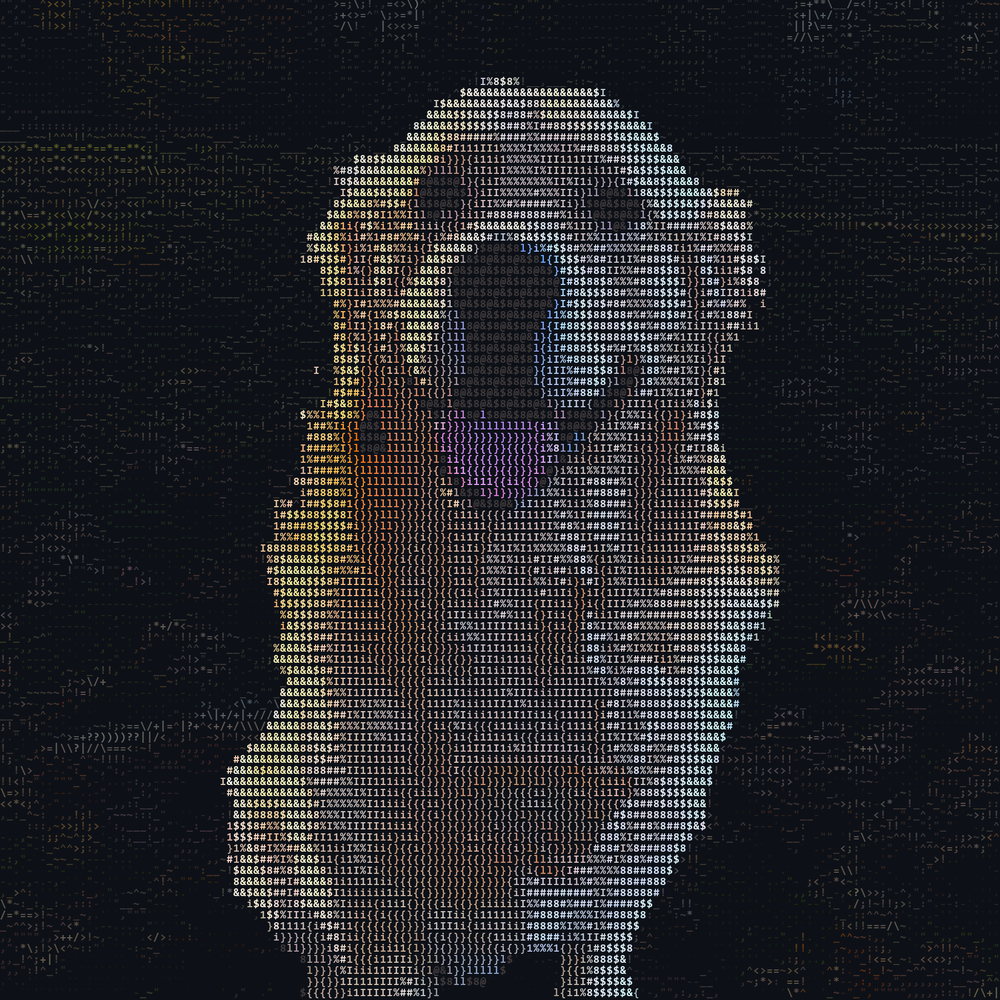

  

<h1 align="center">Hey, I'm Tyler 👋</h1>

  Mechanical engineering student at Miami University · Founder of Woodward AI Automation · I build with AI

  <a href="https://woodwardaiautomation.com">woodwardaiautomation.com</a> ·
  <a href="https://linkedin.com/in/tylerstephenwoodward">LinkedIn</a>

---

### About me

- 🎓 Studying **mechanical engineering** at Miami University in Oxford, Ohio.
- 🤖 Running **Woodward AI Automation**: AI receptionists, missed-call text back, booking, reviews and follow-up for local and home service businesses.
- 🛠️ I build by directing AI agents (Claude Code, Codex). I plan the system, the agents write the code, and I test it until it works.
- ❄️ Engineering internship in industrial refrigeration.
- 🔍 Looking for **AI-focused internships**, remote or around Toledo, Ohio.

### Things I've built

| Project | What it is |
|---|---|
| **Sign shop website + live designer** | A website for a stainless steel address sign shop. Type your number and see it cut through steel on a real wall, in 2D or 3D, with live pricing and quote requests. |
| **AI follow-up and receptionist systems** | Answers calls, texts back missed calls, books jobs and follows up for local service businesses. |
| **My AI operating system** | One shared brain that every AI I use (Claude, Codex and a team of agents) reads from, so any project can pick up where the last session left off on any of my computers. |
| **Online hat brand** | A brand website with a Shopify store, built with my co-founder. |
| **Paper-trading bot** | An automated crypto trading bot that practices with paper money. |

### What I work with

`Claude Code` · `Codex` · `JavaScript` · `three.js` · `Python` · `Blender` · `Vercel` · `GoHighLevel` · `Shopify` · `Google Apps Script`

### Meet the dog

The picture up top is my golden retriever, redrawn entirely out of keyboard characters like `; ' [ ] { } " : / . ? > <`.

---

<i>Always building something.</i>

