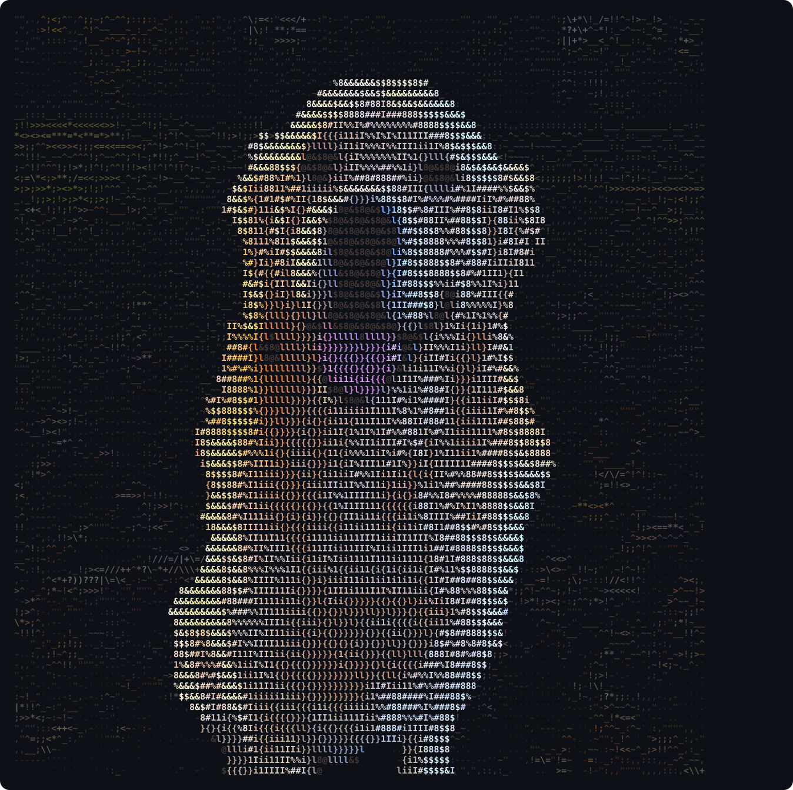

  

<h1 align="center">Hey, I'm Tyler 👋</h1>

  Mechanical engineering student at Miami University · Founder of Woodward AI Automation · I build with AI

  
  <a href="https://linkedin.com/in/tylerstephenwoodward">LinkedIn</a>

---

### About me

- 🎓 Studying **mechanical engineering** at Miami University in Oxford, Ohio.
- 🤖 Running **Woodward AI Automation**: AI receptionists, missed-call text back, booking, reviews and follow-up for local and home service businesses.
- 🛠️ I build by directing AI agents (Claude Code, Codex). I plan the system, the agents write the code, and I test it until it works.
- ❄️ Engineering internship in industrial refrigeration.
- 🔍 Looking for **AI-focused internships**, remote or around Toledo, Ohio.

### What I work with

`Claude Code` · `Codex` · `JavaScript` · `three.js` · `Python` · `Blender` · `Vercel` · `GoHighLevel` · `Shopify` · `Google Apps Script`

### Meet the dog

The dog up top is my golden retriever, typed out entirely in colored keyboard characters like `; ' [ ] { } " : / . ? > <`.

---

<i>Always building something.</i>

